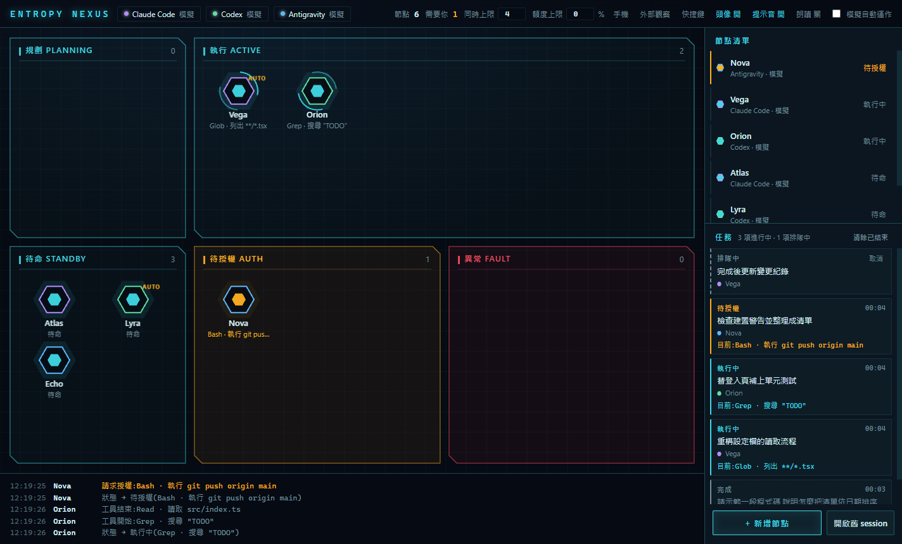
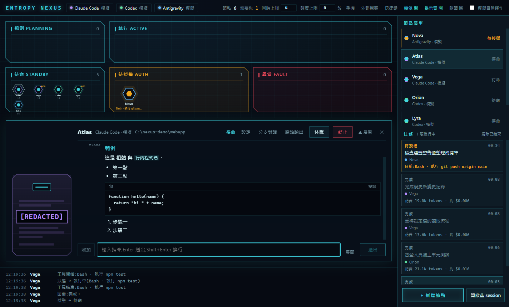

# Entropy Nexus

把 Claude Code、Codex、Antigravity 三家 CLI 的 agent 集中在一個科技風面板上管理的桌面主控台。

它不自己實作 agent,而是啟動你已經安裝並登入的 CLI,把各家的輸出翻譯成同一套事件,讓你在同一個畫面看狀態、下指令、處理授權,並讓不同家的 agent 互相交辦工作。

## 功能

- **主面板**:節點依狀態分在規劃、執行、待命、待授權、異常五個區塊,一眼看出哪個節點需要你。可顯示角色立繪與 Q 版頭像。
- **對話與任務**:即時串流、指令排隊、附件與貼圖、回覆排版、任務面板、花費與剩餘額度。
- **變更檢視**:任務前後拍工作區快照,不論哪一家 CLI、用工具還是用指令改的都看得到;可還原、提交、留行內評論,或送交其他節點審查。
- **獨立工作區**:節點可以在自己的 git worktree 與分支上工作,互不覆寫。
- **節點互相呼叫與會議**:主控台提供一組本機工具,讓不同家的 agent 互相提問、交辦工作,或召開多輪討論的會議。
- **遠端操作**:手機版頁面,以及另一台電腦瀏覽器可用的完整介面;配對的裝置分完整、操作、唯讀三種角色,並留操作紀錄。
- **外部觀察**:用 hooks 觀察在主控台以外執行的 Claude Code。
- **其他**:開啟舊 session、分支對話、終端機模式、角色卡、提示音與朗讀。

## 文件

- [功能說明](docs/功能說明.md):每項功能的行為、限制與設定。
- [安裝、執行與測試](docs/安裝與測試.md)
- [安全須知與聲明](docs/安全須知與聲明.md):使用前請先看過。

授權:[MIT](LICENSE)
